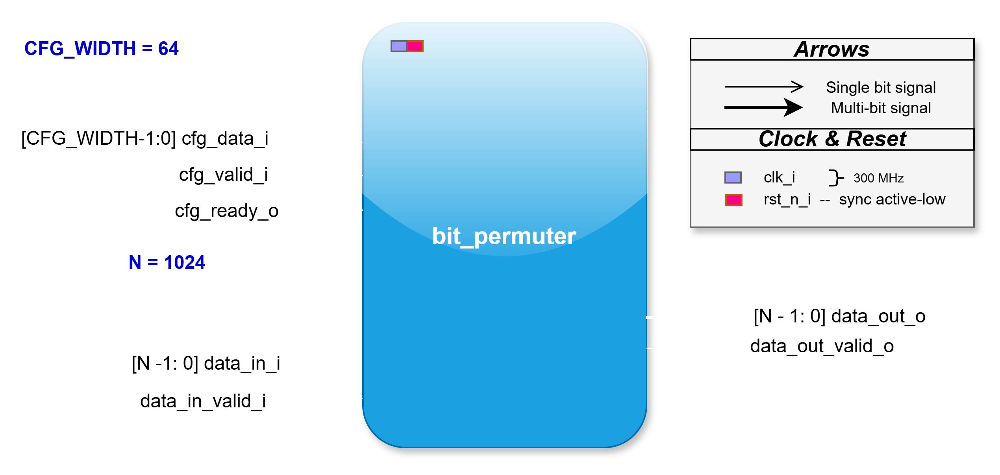
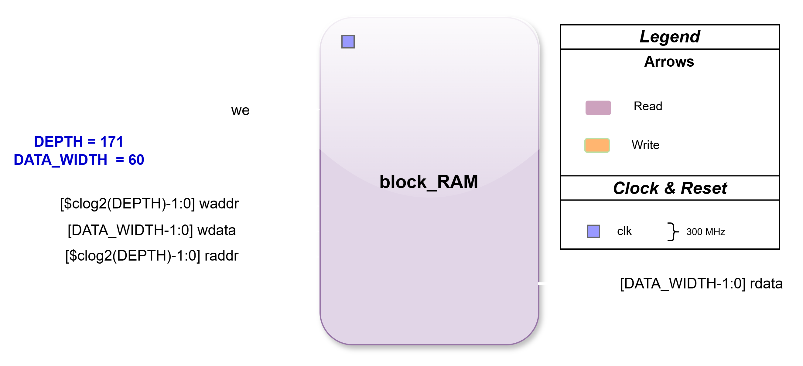
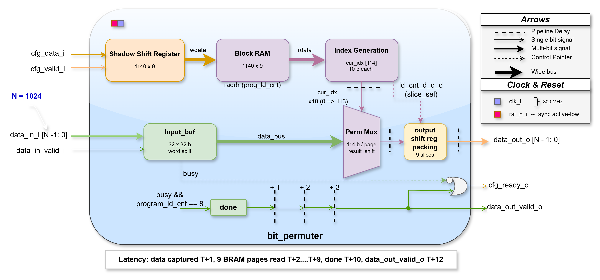

# Bit Permuter Engine

A configurable **N-bit programmable permutation engine** designed for FPGA `xc7z030ffg676-3 (Zynq-7000 series)` \
The design supports runtime reconfiguration of bit ordering using a streamed configuration interface and a BRAM-backed index storage architecture.

---

# 📋 Overview

| Parameter | Value |
|---|---|
| Bit width (N) | 1024 (default, parameterizable) |
| Clock | 300 MHz |
| Config word size | 64-bit |
| Indices per config word | 6 (default) |
| BRAM depth | 9 pages (configurable) |
| Latency | data captured T+1, BRAM pages read T+2…T+9, `done` at T+10, `data_out_valid_o` at T+12 |
| Throughput | 1 data permutation per 1 µs, sustained, back-to-back capable |
| Default state | Identity mapping (unprogrammed) |

---

# 🚀 Key Features

- Parameterized bit-width (`N = 1024 default`)
- Ready/valid handshake protocol based Streaming configuration interface
- BRAM-based permutation table
- Shadow buffering for safe programming
- Fully pipelined datapath
- Identity mapping by default (unprogrammed state)
- FPGA synthesis optimized (Vivado-friendly)
- 1us data input throughput sustainable at 300MHz

---

# 📁 File Structure

```
src/bit_permuter.sv          Synthesisable top-level module
    Block_RAM.sv             Synthesisable BRAM module
log/timing_summary.rpt       synthesis Timing report
    utilization_rpt.txt      synthesis Utilization report
tb/bit_permuter_tb.sv        Self-checking testbench (10 test cases)
README.md                    This file
top.xdc                      300 MHz clock
run.tcl                      script to run simulation and synthesis
```

---

# 🧠 High-Level Flow

    DATA PATH 1 ==> cfg_data → Shadow Buffer → BRAM → Index Lookup 
                                                          |
                                                          v
    DATA PATH 2 ==> data_in → Input Buffer → Permutation Engine → Output

### Top-level I/O



---

# 🧩 Functional Blocks

## 1. Configuration Interface
- Accepts 64-bit streamed config words
- Packs indices into internal memory
- Uses cfg_ready_o backpressure control
- parametrizable index count per config (default=6, where N=1024)

## 2. Program Memory (BRAM)
- Stores permutation tables
- Depth: 9 pages (configurable)
- Backed by a standalone parameterized BRAM wrapper (`Block_RAM.sv`, `DEPTH` / `DATA_WIDTH` parameters), shown below:



## 3. Input Buffer
- Splits N-bit input into 32-bit chunks
- Enables efficient bit addressing
- Output is reassembled by page: 114 bits/page across 9 output pages

## 4. Permutation Engine
- Uses index lookup to reorder bits
- Supports:
  - Programmed mode (BRAM)
  - Default identity mapping

## 5. Output Pipeline
- Multi-cycle pipelined output
- Ensures high throughput

### Internal microarchitecture

Shadow shift register → BRAM → index generation → perm mux → output shift/packing, sequenced by a control counter (`busy && program_id_cnt == 8 → done`) that steps through BRAM page reads T+2…T+9:



---

# ⏱️ Pipeline Timing

- **Latency:** ~12 cycles end-to-end — data captured T+1, BRAM pages read T+2…T+9, `done` at T+10, `data_out_valid_o` at T+12 (pipeline- and BRAM-depth dependent).
- **Throughput:** 1 data permutation per 1 µs, sustained, can accept data continuously.

---

# 🔄 Operation Flow

1. Configuration stream loads permutation indices
2. BRAM stores full mapping
3. Input vector is received (N-bit)
4. Indices are fetched from BRAM or default logic
5. Bits are selected from buffered input
6. Output is assembled and pipelined

---

# 📡 Interface Specification

## Inputs
| Signal | Description |
|--------|-------------|
| clk_i | Clock |
| rst_n_i | Reset (active low) |
| cfg_data_i | Configuration stream |
| cfg_valid_i | Config valid |
| data_in_i | Input vector |
| data_in_valid_i | Input valid |

## Outputs
| Signal | Description |
|--------|-------------|
| cfg_ready_o | Config backpressure |
| data_out_o | Permuted output |
| data_out_valid_o | Output valid pulse |

---

# ⚙️ Configuration Format

- Each configuration word (64-bit) contains multiple indices, default=6
- cfg_data_i = { idx5, idx4, idx3, idx2, idx1, idx0 } \
- 171 transactions for full N=1024 indexes on default configuration
- Each index maps: output_bit[i] = input_bit[index[i]]

---

# 🖥️ Simulate + Synthesis (Vivado xsim)

`` Open Vivado and run following commands in the tcl consol `` \
Make sure to place Programmable-Bit-Permutation-Engine folder in C or change the run.tcl for custom path
```bash
cd C:/Programmable-Bit-Permutation-Engine/  NOTE==> modify the path if folder placed anywhere else then C drive
source run.tcl
```

**Expected output:**

If any test fails:
```
RESULT >> 
EXPECTED = <DATA>
ACTUAL   = <DATA>
Fatal: DATA MISMATCH
```

If all tests pass:
```
================
ALL TESTS PASSED
================
```

---

# 🧪 Verification

The self-checking testbench (`tb/bit_permuter_tb.sv`) covers 10 test cases and reports `ALL TESTS PASSED`, or a `DATA MISMATCH` with expected/actual values on failure.

Recommended assertions (add-on, not yet in RTL):
```
assert (cur_idx[i] < N)                    // Index bounds
assert (!cfg_valid_i || cfg_ready_o)       // CFG handshake safety
assert (!$isunknown(program_rdata))        // BRAM integrity
```

---

# 📈 Design Strengths

- Fully scalable architecture
- FPGA BRAM optimized
- High throughput streaming design
- Clean separation of config vs data plane

---

# ⚠️ Limitations

- Fixed pipeline depth
- BRAM latency dependent
- No partial reconfiguration support
- Assumes sequential CFG and index framing

---

# 🔧 Future Improvements

- AXI4-Stream interface wrapper
- Parameterized pipeline depth
- Partial reconfiguration support
- Utilization of remaining config bits

---

# 🗂️ Revision History

| Date | Version | Author | Change |
|---|---|---|---|
| | 1.0 | | Initial release |